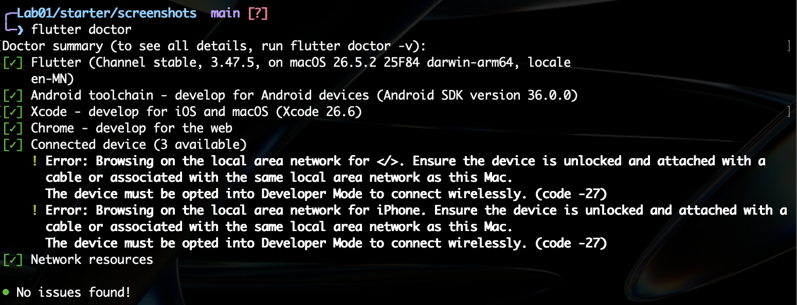
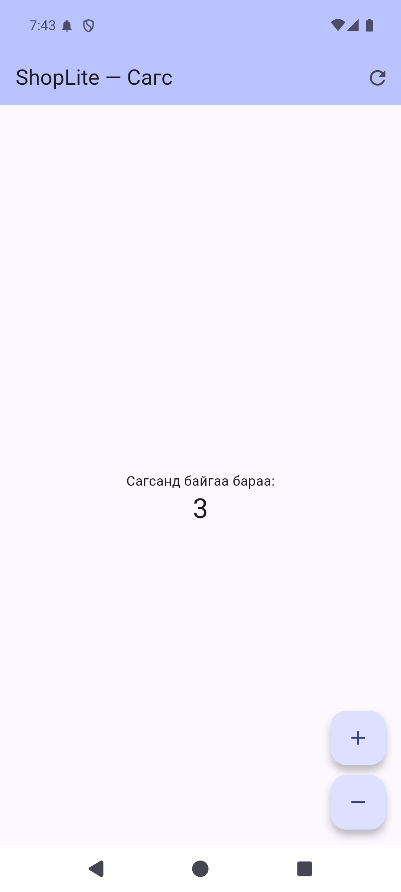

# ShopLite — Мобайл апп хөгжүүлэлт (Flutter)

**Нэр:** …  
**Оюутны код:** …

Энэ репозиторид 6 долоо хоногийн турш бүх лабораторийн кодоо хадгална.

```
├── README.md          ← энэ файл (доорх хэсгүүдийг бөглөнө)
├── screenshots/       ← дэлгэцийн зураг
├── lab1_dart/         ← Лаборатори 1: Dart дасгал
└── shoplite/          ← Лаборатори 1-д `flutter create`-оор үүсгэнэ
```

## Код хадгалах (лаборатори бүрийн төгсгөлд)

```bash
git add .
git commit -m "Lab 1: Dart модель, shoplite апп"
git push
git tag v0.1            # Лаб 1 → v0.1, Лаб 2 → v0.2, ...
git push origin v0.1
```

Push хийсний дараа GitHub дээрх **Actions** табаас автомат тестийн үр дүнг (ногоон ✓ / улаан ✗) харна.
`lab1_dart/test/` болон `.github/` хавтасны файлуудыг **өөрчлөхгүй**.

---

## Лаборатори 1




### lab1_dart

- `dart test test/lab1_test.dart`: 25 / 25
- Бонус B1 (`dart test test/bonus_test.dart`): хийсэн

### D2. Төслийн бүтэц

1. `lib/main.dart`-д ямар классууд байна? Аль нь StatelessWidget, аль нь StatefulWidget вэ?
   > `MyApp` (одоо `ShopLiteApp`) — StatelessWidget, MaterialApp-ийг үүсгэнэ. `MyHomePage` — StatefulWidget, гарчгийг (`title`) авна. `_MyHomePageState` — `MyHomePage`-ийн State класс, `_count` хувьсагчийг хадгалж `setState`-ээр дэлгэцийг шинэчилнэ.
2. `pubspec.yaml`-д ямар сангууд байна?
   > dependencies: `flutter` (SDK), `cupertino_icons` (iOS загварын icon-ууд). dev_dependencies: `flutter_test` (widget тест бичих), `flutter_lints` (кодын хэв маягийн шалгалт).
3. `android/` хавтас юунд хэрэгтэй вэ? Та ихэвчлэн аль хавтсанд код бичих вэ?
   > `android/` нь Android-д зориулсан native төсөл (Gradle тохиргоо, AndroidManifest.xml, applicationId, icon г.м). Flutter апп-ыг APK болгож build хийхэд хэрэглэгдэнэ. Код ихэвчлэн `lib/` хавтсанд (Dart), тестээ `test/` хавтсанд бичнэ.

### D4. Hot reload ба hot restart

| Өөрчлөлт | Hot reload (r) | Hot restart (R) |
|---|---|---|
| AppBar-ийн гарчгийг өөрчлөх | Гарчиг шууд солигдсон, тоолуур 3 хэвээр | Гарчиг солигдсон, тоолуур 0 болсон |
| seed өнгийг солих | Өнгө шууд солигдсон, тоолуур 3 хэвээр | Өнгө солигдсон, тоолуур 0 болсон |
| `int _count = 0;` → `= 5` | Юу ч өөрчлөгдөөгүй, тоолуур 3 хэвээр | Тоолуур 5 болсон |
| `main()` дотор `print('start');` нэмэх | Терминалд юу ч хэвлэгдээгүй | Терминалд `start` хэвлэгдсэн, тоолуур 0 болсон |

**Дүгнэлт:** аль тохиолдолд тоолуурын утга (state) хадгалагдсан бэ? Яагаад?
> Hot reload (r) хийхэд бүх тохиолдолд тоолуур хадгалагдсан. Hot reload нь шинэ кодыг ачаалаад зөвхөн `build()`-ийг дахин дууддаг, State объект хэвээрээ үлддэг. Тиймээс `_count = 5` гэсэн анхны утга (State үүсэх үед нэг л удаа олгогддог) болон `main()` дахин ажиллахгүй. Hot restart (R) нь аппыг `main()`-оос эхнээс нь ажиллуулж, бүх State-ийг шинээр үүсгэдэг тул тоолуур анхны утга руугаа (0 эсвэл 5) буцна.
